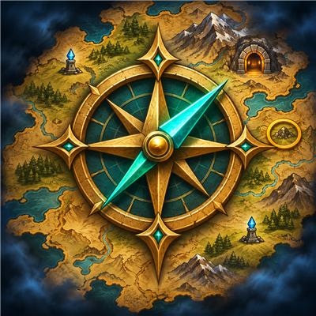

# Cartographer Forever



Cartographer Forever adapts [Cartographer 2.5.3](https://www.wowinterface.com/downloads/info6403-Cartographer.html) for **WoW Forever**. It opens a movable, resizable map window with detailed terrain, quest markers, dungeon maps, travel points, coordinates, and fog of war controls. The addon renders its own map with the client's modern `MapCanvas` and `C_Map` APIs instead of displaying the stock `WorldMapFrame`.

Designed for **WoW Forever 1.60.1** (Interface `16001`).

## Features

- **Seven independent map layers:** detailed terrain, quest markers, instance entrances, dungeon and raid maps, ships and zeppelins, flight points, and spirit healers. Settings persist between sessions. Detailed terrain starts off; the other layers start on.
- **Dungeon and raid maps:** open them from the **Dungeons** menu or by left-clicking an entrance marker. Available floors are included. When you open the map inside a dungeon, its map appears automatically; **H** returns to your current dungeon map. Right-click a dungeon map to return to its outdoor zone.
- **Zone information:** hover over a zone to see its recommended level range and available Forever dungeons. Cursor and player coordinates appear at the bottom left; player coordinates always refer to the character's current zone.
- **Fog of war control:** unexplored areas are shown by default. Press **F** to show or hide fog in this window. This display setting never marks an area as explored for your character.
- **Client map data:** detailed terrain uses minimap tiles already present in the game client, with building tiles for six capital cities. Quest markers come from the client and also respect its quest display settings.

## Installation

Download the [current addon package](Cartographer_Forever-0.5.8.zip) and extract it, or use the `AddOns\Cartographer_Forever` directory from this repository. Copy the extracted `Cartographer_Forever` directory into your WoW Forever installation:

```text
C:\Program Files (x86)\World of Warcraft\_forever_\Interface\AddOns\
```

The resulting file path should be:

```text
...\_forever_\Interface\AddOns\Cartographer_Forever\Cartographer_Forever.toc
```

Replace files from an older copy, enable the addon in the game's addon list, and restart the game. The bundled dungeon maps do not require Forever Instance Maps or DungeonJournal to be installed separately.

## Controls

| Input | Action |
| --- | --- |
| **M** or your assigned world map key | Open or close the Cartographer Forever window |
| **O** | Open the seven map layer switches |
| Mouse wheel over the map | Zoom the map |
| **Ctrl + mouse wheel** | Resize the window |
| **Shift + mouse wheel** | Change opacity |
| Drag the title bar | Move the window |
| Left-click / right-click on the map | Enter a zone / return to its parent map |
| **H** / **F** | Return to your location / toggle fog of war |
| **−** / **+** / **X** in the title bar | Resize the window / close it |
| **Esc** | Close the window |

The title bar also has a **<** button for the parent map and a **Dungeons** dropdown. On the first opening after login, the window expands to the largest size that fits on screen. Window resizing is limited by screen size.

### Chat commands

`/cf` and `/cf map` toggle the map. `/cartographerforever` is an alias.

| Command | Action |
| --- | --- |
| `/cf size 0.60-1.25` | Set window scale within that range |
| `/cf alpha 0.40-1` | Set window opacity within that range |
| `/cf fog off` / `/cf fog on` | Hide / show fog of war |
| `/cf reset` | Reset window size, opacity, and position |
| `/cf key off` / `/cf key on` | Restore the stock map key / let Cartographer Forever use it again |
| `/cf detail|quests|entrances|instances|transport|flights|spirits on|off` | Enable or disable one layer, for example `/cf flights off` |

## Map data and limitations

The map window retains the familiar resize, opacity, drag, and saved-position behavior of `Cartographer_LookNFeel`. Its old files are not bundled. Cartographer's original `WorldMapButton`, `WorldMapDetailFrame`, and Rock/Ace2 map rendering do not work in the Forever client, so this adaptation uses `MapCanvas`. The old `WorldMapDetailTile*` textures are replaced by modern map layers. The zone label follows the style of `Cartographer_ZoneInfo` without bundling its 2009 level table.

Recommended zone levels come first from Forever's Group Finder, matched to map IDs. A table for client build `1.60.1.70938` provides a fallback, checked against [EndgameTools' zone ranges](https://endgametools.com/en/wow-forever/news/wow-forever-leveling-zones). Shen'dralas has no Group Finder entry yet, so its approximate range is marked `~`. Dungeon names and level ranges were checked against [Blizzard](https://worldofwarcraft.blizzard.com/en-us/news/24301455/explore-the-new-dungeons-of-world-of-warcraft-forever) and [Wowhead Forever](https://www.wowhead.com/forever/guide/dungeons-overview-locations-details). Raids that are not yet open are not shown in the zone information.

The fog data covers 84 maps. Unexplored areas on newer or changed maps outside that data may not reveal completely. When the client cannot provide a fog mask for detailed terrain, the addon uses the standard illustrated map so unexplored terrain is not exposed while fog is enabled.

The current package includes 49 painted dungeon map textures in BLP2 DXT1 format with mipmaps. Original Cartographer modules for notes, gathering, guild position sharing, and boss loot are not part of this adaptation.

## Credits

- **Adaptation, integration, documentation, and cover artwork:** the Cartographer Forever project maintainer, with assistance from **OpenAI Codex (ChatGPT)**. The compass artwork above was generated for this project.
- **Original design and controls:** [Cartographer](https://www.wowinterface.com/downloads/info6403-Cartographer.html) by ckknight and Arrowmaster.
- **Detailed terrain and dungeon tile geometry:** [TerrainWorldMap](https://github.com/Dramacydal/TerrainWorldMap) by Dramacydal, under the MIT license included as [DetailMap-LICENSE.txt](AddOns/Cartographer_Forever/DetailMap-LICENSE.txt).
- **Fog of war data:** [Map Tab](https://github.com/jonlipin/map-tab) by jonlipin, under the MIT license included in [FogData.lua](AddOns/Cartographer_Forever/FogData.lua).
- **Painted dungeon maps:** sourced from [Forever Instance Maps](https://www.curseforge.com/wow/addons/forever-instance-maps) by R0yalFluffy and [DungeonJournal](https://www.curseforge.com/wow/addons/dungeonjournal) by ExehnTV (Exehn in the addon's metadata). Forever Instance Maps credits the new Forever dungeon illustrations to [Santiago Reyes, creator of *Atlas de Azeroth: Forever*](https://asguevara433.wixsite.com/srmaps/post/proyecto-atlas-de-azeroth-forever).
- **Map locations and reference data:** [Leatrix Maps](https://www.curseforge.com/wow/addons/leatrix-maps), [EllesmereUI](https://www.curseforge.com/wow/addons/ellesmereui), [BetterMaps](https://www.curseforge.com/wow/addons/bettermaps), Blizzard, Wowhead Forever, [MMonster](https://mmonster.co/de/wow-forever/tools/world-map), and EndgameTools.
- **Game artwork and live map and quest data:** Blizzard Entertainment. The bundled transport icon and Temple of Atal'Hakkar map come from game assets.

## Verification

The current build targets Forever client `1.60.1.70938` with Interface `16001`. The package was checked for TOC entries, 49 BLP2 map textures and their mipmaps, map keys, travel and spirit healer markers, and archive contents. Sample maps were visually compared before and after compression. Verification inside the game is still pending.
